  
## Eshan Sengupta ##
  
**ML CV Engineer**

---

## 🔬 About Me

I am an M.Sc. student in Artificial Intelligence Systems at Vilnius Gediminas Technical University (Vilnius Tech). My core work revolves around **Machine Learning, Computer Vision, Edge/Fog Computing, and Intelligent IoT Systems**. I have authored/co-authored **12 peer-reviewed journal articles** (Springer/Inderscience) and **6 conference proceedings** (IEEE/Springer).

---

## 💻 Tech Stack

### Programming & Databases

### ML, AI & Computer Vision

### Robotics, Sensors & Perception

### Robotics Middleware & Frameworks

### Cloud, Tools & Data Engineering

---

## 💼 Professional Experience
* **Laborantas @ Transporto ir logistikos kompetencijos centras, Vilnius Tech** *(Sep 2026 - Present)*
* **Research Intern @ AMM Group, IHA, Tampere University, Finland** *(Oct 2026 - Oct 2026)*
* **IT Intern @ Bangladesh Steel Re-Rolling Mills (BSRM)** *(Sep 2024 – Mar 2025)*
* **Database Administration Trainee @ New Technology Systems Ltd.** *(Aug 2024 – Sep 2024)*
* **Graduate Engineering Trainee @ Deepesh Cyber Developers** *(Jan 2024 – Jun 2024)*

## 🏆 Highlights & Leadership

* 🥇 **Full ICCR Scholarship:** Fully funded scholarship by the Indian Council of Cultural Relations for B.Tech in CSE at GNDU, India.
* 🧑‍💼 **Microsoft Learn Student Ambassador:** Reached the 2nd highest milestone; hosted Azure AI workshops for 40+ participants.
* 👥 **Chairperson, GFG Student Chapter GNDU:** Managed 7 leads and 50+ volunteers across 6 technical events.
* ☁️ **Google Cloud Career Practitioner:** Tier 3 achiever with 35+ Google Cloud certifications.
* 🎨 **Creative Pursuits:** Oil pastels, acrylics, and sketching enthusiast; exhibited works in two group art shows.
